### 3.1 统一的图查询计划表征与优化技术

图数据库面向以顶点和边组织的数据，既要回答由若干固定边模式组成的子图查询，也要处理带有变长路径、分支合并和可选匹配的复杂查询。面向 RDF 图的 SPARQL 与面向属性图的 Cypher、GQL、SQL/PGQ 在语法和数据模型上存在差异，但其核心查询能力均可归入 UCRPQ（Union of Conjunctive Regular Path Queries，合取正则路径查询的并集）：基本图模式对应固定长度的图结构匹配，正则路径查询（RPQ）用于描述边标签序列满足正则表达式的可变长度路径，合取正则路径查询（CRPQ）通过共享变量连接多个 RPQ，UNION、OPTIONAL 等算子则进一步组织不同分支及可能缺失的匹配结果。

长期以来，上述查询能力通常由不同技术路线分别处理：子图查询采用树形连接计划，RPQ 采用有限自动机或带不动点算子的扩展关系代数，UNION、OPTIONAL 则依照查询语法树在更高层执行。这种割裂方式难以系统地利用不同查询成分之间的选择性，也无法在统一计划空间中比较等价执行方案。项目组围绕图查询的“表示—枚举—估计—执行”全过程开展连续研究：首先以原生图存储和子图匹配处理基本图模式；继而研究重复 RPQ 工作负载中的物化视图选择和基于视图的规划；随后建立同时覆盖子图匹配和 RPQ 的可组合 CRPQ 代数；最后面向 UNION、OPTIONAL 构造可变换的复杂 SPARQL 计划并在运行时传递候选约束。四项工作由基本图结构逐层扩展至路径、合取和复杂结果算子，形成统一的图查询计划表征与优化技术体系。

#### 3.1.1 以子图匹配方法回答合取查询

（沿用 Word 文档中 3.1.1 的原有内容。）

#### 3.1.2 面向正则路径查询的物化视图选择与查询规划

本技术点对应论文 *Materialized View Selection & View-Based Query Planning for Regular Path Queries*。论文首先从 RPQ 工作负载而非单条即席查询出发，定义有限内存条件下的物化视图选择问题；随后提出可同时表达多条 RPQ 及其等价计划的 AODC，在这一表示上依次完成查询规划、查询执行、视图冗余检测和增量重规划；最后建立覆盖完整 RPQ 语法的代价与基数估计方法，并在大规模 Wikidata 图和真实查询日志上验证整体方案。以下依照这一逻辑介绍。

##### 3.1.2.1 研究问题与形式化定义

给定边标签有向图 $G=(V,E,\Sigma,l)$，其中 $V$、$E$、$\Sigma$ 分别为顶点、边和边标签集合，$l:E\rightarrow\Sigma$ 为边标签函数。一个完整 RPQ $R$ 可由空路径 $\epsilon$、正向或反向单标签 $a$、$a^{-}$，以及连接 `/`、选择 `|`、零次或一次 `?`、Kleene 星号 `*` 和 Kleene 加号 `+` 递归构成。$R$ 在图 $G$ 上的结果记为 $[R]_G$，它是所有满足下述条件的顶点对集合：两顶点之间至少存在一条路径，其边标签序列被 $R$ 所描述的正则语言接受。连接对应两个顶点对集合在前一结果终点和后一结果起点上的连接，选择对应集合并，$R^+$ 对应一次以上的重复连接，$R^*$ 则在 $R^+$ 结果上加入空路径结果。

RPQ 已被 SPARQL 和 ISO/GQL 完整支持，openCypher 也支持其中不含连接运算的标签约束可达性片段。它适用于蛋白质相互作用网络中的信号通路检索、公共图查询端点中的重复日志查询以及可视化查询系统一次生成的多条相似路径查询。例如，`knows+/moderates` 可返回“经过一次或多次认识关系后到达某位论坛管理员”的用户—论坛顶点对。此类应用往往反复执行一组结构相近的 RPQ，若预先计算并保存公共子查询结果，在线查询可直接读取视图或仅计算其余部分。

论文将物化视图定义为二元组 $\langle R,[R]_G\rangle$，其中查询 $R$ 决定视图语义，$[R]_G$ 是实际保存的顶点对。设工作负载 $S=\{R_1,\ldots,R_k\}$，每条查询还带有在日志中的出现频率；在内存预算 $b$ 下，需要选择视图集合 $\mathcal V$，使各视图结果基数之和不超过预算，同时最小化利用这些视图执行整个工作负载的加权总代价。该目标不同于仅最小化视图空间，也不同于对临时查询批次共享一次中间计算：物化视图可以离线构建并在未来多次复用，因此优化重点是长期在线查询代价与有限存储预算之间的权衡。

论文进一步证明该问题是 NP-hard。直观上，候选子查询数量随工作负载增长，可能的视图组合呈指数增长；一个视图的收益又取决于其他哪些视图已被选择。简单地按查询频率或单个视图收益贪心会产生重叠甚至失效的视图。例如，在包含 `(a/b/c)+` 等结构的工作负载中，物化 `a/b/c` 后，`a/b` 可能不再出现在任何最优计划中，但 `b/c` 仍可能被其他查询或分支独立使用。可见，正则表达式字符串之间的包含关系不足以判断视图是否冗余，必须显式表示“子查询—等价计划—工作负载查询”之间的依赖关系。

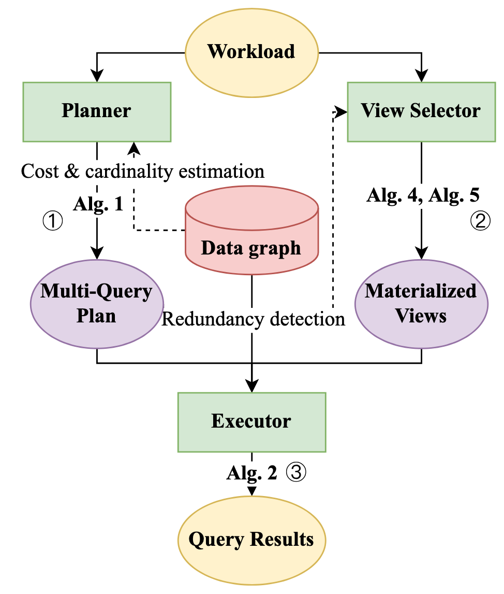

##### 3.1.2.2 AODC 多查询计划表示

关系数据库中的 AND-OR DAG 用两类交替节点同时保存多个查询的公共子计划和等价计划：OR 节点表示一个关系子表达式，其不同 AND 子节点表示不同计算方法；AND 节点表示具体代数运算，其子节点是操作数。传统 AND-OR DAG 不具备 RPQ 所需的 Kleene 闭包语义，也没有体现路径连接的左右方向和边标签顺序。项目组在此基础上引入完整 RPQ 运算，提出 AND-OR DAG with Closure（AODC）。

AODC 是一个有向无环图，具有如下结构约束：

- 每个 OR 节点由一个互不重复的 RPQ 标识；工作负载中的完整 RPQ 对应根节点，相同子查询在不同查询和不同计划之间只保留一个共享 OR 节点。
- 每个 AND 节点由 `/`、`|`、`?`、`*` 或 `+` 运算标识，其子 OR 节点对应该运算的操作数。
- 一个 OR 节点的 AND 子节点表示计算该 RPQ 的不同等价方案。构造时按照运算符优先级自顶向下分解：对于多个最低优先级的连接运算，每一个合法的括分位置形成一个候选 AND 子节点；对选择运算则把多个分支合并到同一个 AND 节点，因为分支求并的顺序不改变主要执行代价。
- 工作负载逐条加入 AODC。后加入查询遇到已有 RPQ 子表达式时直接复用相应 OR 节点，因此图中的路径不仅表示语法分解，也表示不同查询之间可以共享的计算。

这种结构保留了 RPQ 边标签的既定顺序，但枚举了所有合法的连接结合次序。例如 `a/b/c` 不能错误地改写为 `(a/c)/b`，但可以比较 `(a/b)/c` 与 `a/(b/c)`；每个连接还可选择从左向右或从右向左执行。AODC 因此承担两项任务：一是把整个工作负载的候选计划压缩到一个共享 DAG 中，避免重复规划公共子查询；二是以 OR 节点和最优执行树之间的从属关系刻画候选视图的实际用途，为后续冗余检测提供结构基础。

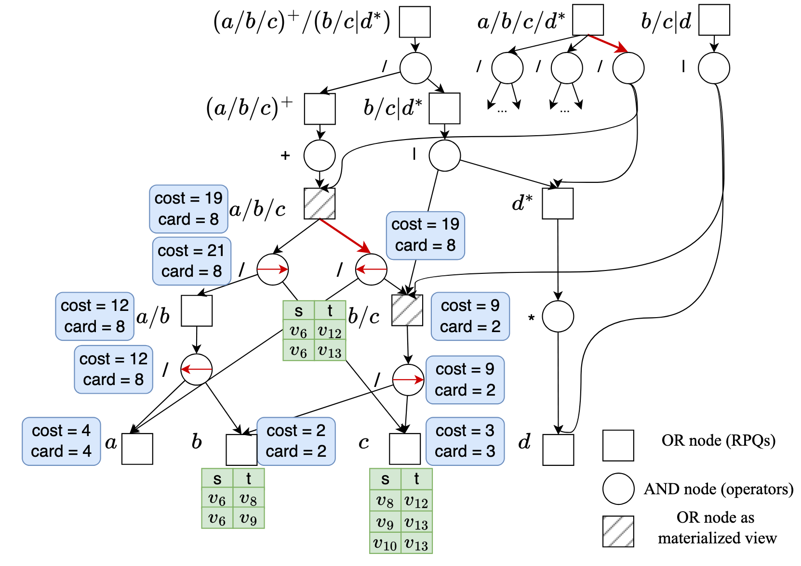

##### 3.1.2.3 基于 AODC 的查询规划与执行

在尚未使用物化视图时，单标签叶节点的结果基数可直接从图索引获得，扫描代价取为相应标签边数；其他节点的代价和基数由下至上估计。论文的规划算法对每个工作负载根节点执行深度优先遍历，共享节点一经规划即不重复计算。对 AND 节点，优化器根据运算类型和子节点统计量计算该运算的结果基数及执行代价；对 OR 节点，则在等价 AND 子节点中选择估计代价最低者作为 `targetChild`，由此确定最优执行树。连接节点还分别估计正向和反向方案：正向方案先算左操作数，再用所得终点限制右操作数起点；反向方案先算右操作数，再用所得起点限制左操作数终点。优化器选择代价较低的方向并写入节点注记。

查询执行同样沿所选执行树进行深度优先遍历。遇到单标签或已物化 OR 节点时，直接扫描图索引或视图；遇到其他 OR 节点时，只执行其 `targetChild`。连接、选择、可选和闭包 AND 节点分别按 RPQ 语义组合子结果。其中有两项执行机制对控制搜索空间尤为关键。

第一，连接采用横向信息传递（sideways information passing）。若先执行 $R_1$ 得到结果顶点对，则 $[R_1]_G$ 的终点集合被作为 $R_2$ 的候选起点，而不是无约束地计算完整 $[R_2]_G$；从右向左执行时则对称地传递候选终点。该机制使执行代价不仅由连接结果决定，也取决于先执行哪一侧。论文的 Fig. 5 表明，即使两个逻辑计划产生相同最终结果，先执行选择性较高的一侧也可大幅减少另一侧需要访问的边和中间顶点。

第二，Kleene 闭包以增量不动点方式执行。计算 $R^+$ 时，先得到 $[R]_G$，以后每轮只将上一轮新产生的结果与 $[R]_G$ 连接，直到没有新的顶点对产生；$R^*$ 在此基础上还应包含全部 $\langle v,v\rangle$。直接生成全图规模的空路径集合会造成不必要的时间和空间开销，因此系统仅在结果上附加 $\epsilon$ 标记。带该标记的结果参与左侧或右侧连接时，执行器按相应外连接语义处理；仅当最终输出确实需要这些自映射时才展开。这一惰性机制也用于 `?` 运算。

执行器允许处理原工作负载之外的新查询：先把新 RPQ 及缺失子表达式加入 AODC，再运行规划与执行算法；已经存在的共享子计划无需重新规划，已选视图也可立即参与新查询。AODC 对应带完整循环缓存的扩展关系代数计划。与 Waveplan 相比，它没有枚举“不缓存闭包循环”和“部分缓存闭包循环”的方案，但论文预实验和既有研究均表明这两类方案很少优于完整循环缓存，因而这一取舍可换取更便于合并多查询计划的 DAG 结构。

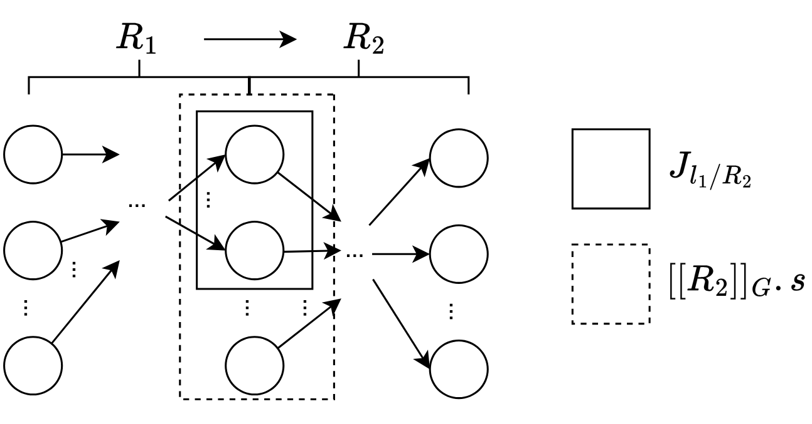

##### 3.1.2.4 视图选择、冗余消除与增量重规划

AODC 规划完成后，每个工作负载查询都对应一棵由 `targetChild` 指针确定的当前最优执行树。论文据此提出精确的运行中冗余判据：一个已物化视图是冗余的，当且仅当代表它的 OR 节点没有出现在任何工作负载查询的当前最优执行树中。系统为每个节点维护使用计数 `useCnt`，即包含该节点的最优执行树数量；初始时从每个工作负载根节点沿目标子节点传播计数，`useCnt=0` 的节点不可能给当前计划带来收益。

视图选择采用以工作负载出现频率为启发式的贪心过程。候选视图按频率降序扫描，每个候选依次通过三项检查：其节点必须仍被至少一个最优计划使用；加入后的总结果基数不得超过预算；将其设为物化后必须降低加权工作负载总代价。估计基数为零的候选即使收益为零也可保留，因为它几乎不消耗空间。通过检查的视图加入集合，并触发 AODC 更新。

当一个 OR 节点物化后，其代价由“重新计算子查询”的代价变为“读取预计算顶点对”的代价，通常可近似为结果基数。这一变化可能使祖先 OR 节点改选另一等价计划，进而改变其他视图的使用状态。系统在应用计划变化时维护三类计数转移：旧目标子树退出父节点所参与的全部最优执行树；新目标子树以同样的父节点使用次数加入；新物化节点自身仍被使用，但其后代不再为得到该节点结果而执行，因而从相应最优树中脱离。若某个先前已选视图的使用计数因此降为零，算法立即将其移出集合并归还内存预算，使后续更有价值的候选仍有机会被选择。论文还证明，一旦某视图在这一过程中变为冗余，后续不会重新成为最终方案中的必要视图：即便令其冗余的视图后来被更高层视图取代，后者也会继续覆盖原有作用。

为避免每加入一个候选都对整个 AODC 重新运行规划，论文设计增量重规划算法。视图物化只直接改变相应 OR 节点的代价，而一个节点的代价变化只可能影响其祖先。因此算法从候选节点开始沿反向边执行深度优先传播，重新计算每个受影响祖先的代价、基数、目标子节点和连接方向；遇到代价不再变化的祖先即停止向上扩散。若祖先是工作负载根节点，则把其代价下降量乘以查询频率，累加为候选视图收益。所有变化先保存在临时差分中，只有候选最终被接受时才写回 AODC。视图选择结束时，AODC 已经同步成为使用最终视图集合的查询计划，无需再执行一次独立的全局规划。

物化阶段按照 AODC 的逆拓扑顺序，从接近叶节点的视图开始计算，使上层视图在构建时能够复用已经物化的下层结果。这将“选什么视图”“如何使用视图”和“按什么依赖顺序构建视图”统一在同一计划结构中。

##### 3.1.2.5 完整 RPQ 的代价与基数估计

规划和视图选择都依赖对子查询代价与结果规模的估计。已有 RPQ 估计方法通常只处理标签串连接，并为每对边标签预存连接集合统计量；在 Wikidata 这类标签数很大的图上，构造该统计摘要耗时高，而且不能直接估计两个任意 RPQ 的连接，更没有覆盖无界 Kleene 闭包。论文建立了适用于 AODC 所有节点的统一模型，并只假定底层存储能够按给定标签在线性于邻居数的时间枚举某顶点的入邻居或出邻居。

对任意连接 $R_1/R_2$，令连接集合 $J_{R_1/R_2}=[R_1]_G.t\cap[R_2]_G.s$，即同时作为 $R_1$ 结果终点和 $R_2$ 结果起点的数据顶点集合。在顶点度数均匀的近似下，结果基数可由连接集合大小、两个子结果基数及其不同起点/终点数推导：

$$
|[R_1/R_2]_G|\approx |J_{R_1/R_2}|\cdot
\frac{|[R_1]_G|}{|[R_1]_G.t|}\cdot
\frac{|[R_2]_G|}{|[R_2]_G.s|}。
$$

连接代价除合并两个子结果的开销外，还要体现横向信息传递带来的缩减：若先执行 $R_1$，则只需在 $J_{R_1/R_2}$ 所占比例对应的起点上执行 $R_2$；反向方案亦然。模型分别计算两个方向后取较小值。连接集合大小不再依赖全标签对摘要，而采用蒙特卡洛采样估计：从可能成为前一子查询终点的顶点中均匀抽样，为 $R_2$ 构造最小确定有限自动机，并从样本顶点运行 DFA 引导的深度优先搜索；一旦找到一条可接受路径即提前返回。命中样本比例乘以候选总体规模，即得到连接集合估计。该方法的对象可以是任意 RPQ，而不局限于单个标签。

对 $R^+$，系统将每轮连接看作递推过程。若 $|[R^i]_G|\approx c^{i-1}|[R]_G|$，其中系数 $c$ 由 $R/R$ 的连接集合及源、目标统计量得到，则闭包基数可近似为截至有效深度 $D$ 的等比和：

$$
|[R^+]_G|\approx \frac{1-c^D}{1-c}|[R]_G|。
$$

这里 $D$ 表示不动点执行仍能产生新结果的最大有效轮数。当 $c<1$ 时，以新增结果量低于阈值推定终止深度；当 $c\geq 1$ 时，根据图的小世界性质取有限经验上界。该估计忽略不同轮次结果集合的重叠，因而倾向于给出安全的上界。$R^*$ 与 $R^+$ 因为空路径采用惰性标记，在内存中的基数估计相同；闭包的不同源集合、不同目标集合分别沿用 $R$ 的源、目标集合估计。选择运算的基数近似为各分支基数之和，代价为各分支计算代价与集合并代价之和；`?` 同样因惰性 $\epsilon$ 处理而沿用子节点估计。

上述模型同时服务于初始规划、候选收益评估和增量重规划：同一套统计语义贯穿视图选择前后，避免出现“按一种模型选择视图、按另一种模型生成计划”的不一致。

##### 3.1.2.6 实验验证与技术效果

论文在包含 348,945,080 个顶点、958,844,164 条边和 5,419 种边标签的 Wikidata 图上实验。数据图按标签使用 CSR 结构存入内存，约占 61 GB；工作负载从 Wikidata 查询日志中执行超过 60 秒的查询提取，经清洗得到 1,930 条 RPQ，其中 442 条互不重复，覆盖连接、选择、逆边及多类 Kleene 闭包组合。

首先，在不使用任何物化视图的条件下，AODC 计划处理全部工作负载耗时 30,187.6 秒，最小 DFA 计划耗时 68,552.4 秒，前者加速 2.27 倍，而规划仅需 13.9 秒。多数查询获得超过 2 倍的加速，部分最终结果较少但 DFA 中间状态扩张严重的查询获得 10 倍乃至 100 倍以上加速，表明连接顺序选择和横向信息传递本身即能显著改善即席 RPQ 执行。

其次，在 $10^9$ 个结果顶点对的视图预算下，AODC 视图选择方案把总查询时间降至 3,102.02 秒，相对无视图的 AODC 方案加速 9.73 倍；视图与数据图的内存比约为 2.15。即使把离线物化时间计入总成本，在较大预算下仍可达到 6.25 倍加速。分模式观察时，含 Kleene 闭包的查询受益最大，两个闭包连接的模式加速可达 236.15 倍；仅含选择运算的 RPQ 因计算代价接近结果读取量，物化收益较小，这与模型预期一致。

最后，与 RTC、Swarmguide、Ring 和 Unit 比较时，本方法取得最高的总体加速比和加速—内存比。RTC 只考虑物化公共闭包，容易被大规模闭包结果耗尽预算；Swarmguide 按自动机标签相似性聚类，可能把拓扑上没有公共子自动机的查询归为一组；Ring 和 Unit 则缺少针对无常量端点、横向信息传递或无界闭包的同等优化。实验说明，AODC 的价值不仅在于保存更多候选计划，还在于把子查询关系、冗余视图识别、基于视图的计划更新和实际执行约束联结为一体。

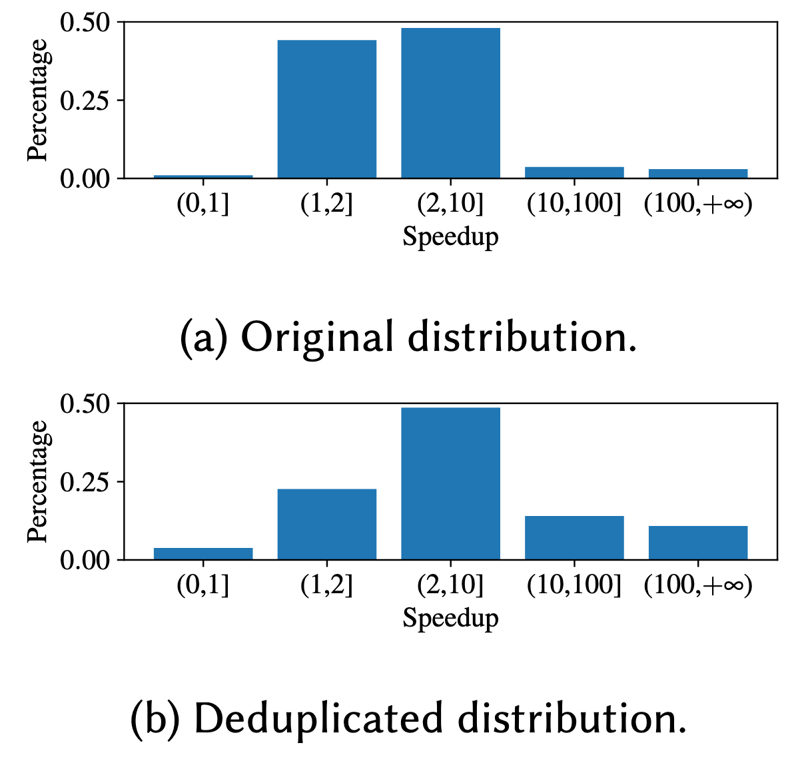

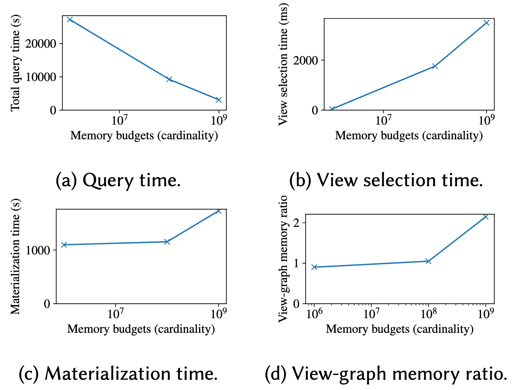

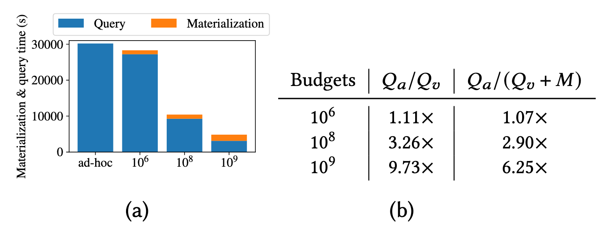

本技术点的代表性论文为 Yue Pang、Lei Zou、Jeffrey Xu Yu、Linglin Yang 的 *Materialized View Selection & View-Based Query Planning for Regular Path Queries*，发表于 *Proceedings of the ACM on Management of Data* 2(3), Article 152（SIGMOD 2024）。相关发明专利申请为“基于物化视图选择和查询规划的正则路径查询方法和系统”（ZL 202410680530.9）。

#### 3.1.3 面向 CRPQ 的统一查询计划表征与优化

本技术点对应论文 *A Unified Query Planning Framework for Conjunctive Regular Path Queries*。论文从现有 CRPQ 优化缺少统一框架这一问题出发，先把 CRPQ 结果重新定义为可继续参与图查询的序列超图，再在该模型上定义六类逻辑算子及其物理实现；随后证明这些算子能够构成完整、封闭且可组合的计划空间，并利用代数等价变换、动态规划和代价估计选择近优计划。以下依照论文从查询模型到计划优化的次序介绍。

##### 3.1.3.1 CRPQ 及统一优化框架的需求

CRPQ 将多个 RPQ 通过共享变量合取。形式上，一个查询可写为

$$
Q(\bar{x})\leftarrow \bigwedge_{i=1}^{k}R_i(y_i,z_i)，
$$

其中每个 $R_i$ 可以是单标签、反向标签、通配边或包含连接、选择、可选及 Kleene 闭包的任意 RPQ，$y_i,z_i$ 可以是查询变量或常量，$\bar{x}$ 为最终投影变量。其结果是各 $[R_i(y_i,z_i)]_G$ 在公共变量上的自然连接再投影到 $\bar{x}$。当所有 $R_i$ 都退化为单边标签时，CRPQ 即为普通子图模式匹配；允许 $R_i$ 表示变长路径后，它便同时具有局部图结构和远距离可达性约束，是 SPARQL、Cypher、GQL 等语言的共同核心。

已有系统往往分别规划两部分：子图匹配采用边扫描和连接树，RPQ 采用自动机或扩展关系代数；二者最后按固定启发式组合。这样做有三个不足。其一，子图计划与路径计划使用不同中间结果类型，难以在同一计划中自由交错；其二，优化器只能枚举各自局部的连接顺序，不能依据数据分布比较“先扩展一条路径”“同时求交多条路径”和“先形成两个局部子图再连接”等全局等价方案；其三，许多方案依赖固定规则，缺少以基数和物理开销为依据的统一选择。

论文据此提出统一框架应同时具有三项能力：一致的算子集合和计划空间；由等价代数规则驱动的系统计划枚举；针对查询结构与底层数据自适应的代价选择。其关键切入点是观察到 RPQ 的连接和子图匹配并非完全不同：前者可看作从当前路径连续遍历，后者也可从已匹配的路径或子图向外扩展，在多条扩展到达同一变量时求交。论文将这种共同操作抽象为 TI（Traverse-Intersect），再以 SJ（Subgraph Join）保留灌木型子图连接，从而打通两类计划表示。

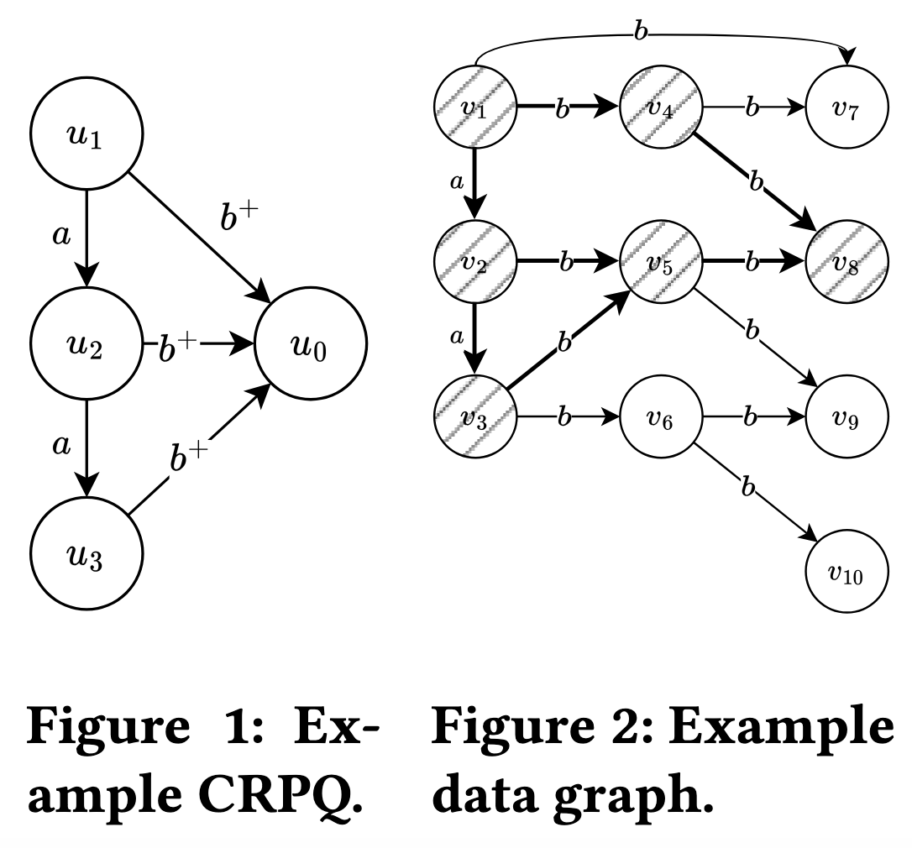

##### 3.1.3.2 以序列超图统一表示中间结果

传统图查询语言通常把匹配结果输出为关系表。表格便于投影和聚合，但其类型不同于输入图；若后续仍要执行图遍历，系统必须重新解释各列的顶点含义，或显式构造中间图视图，破坏算子之间的直接组合。项目组提出以序列超图（sequence hypergraph）表示 CRPQ 结果：每一条超边由一个有序顶点元组组成，顶点顺序与输出变量 $\bar{x}=\langle x_1,\ldots,x_m\rangle$ 一一对应；超边标签记录生成该结果的边、路径或子查询类型。

设某条关系结果为 $\langle u_{i_1},\ldots,u_{i_m}\rangle$，统一模型把它表示为带标签的超边 $\langle u_{i_1},\ldots,u_{i_m}\rangle_{l_Q}$。由全部结果元组构成的超边集合与其中出现的顶点集合共同形成 $m$-一致超图。二元超边可以表示数据图中的普通边或 RPQ 路径结果，多元超边可表示局部子图和完整 CRPQ 结果；变量顺序使投影和后续连接无需猜测端点语义，标签则让优化器区分原始边、路径结果和子图结果。

该模型带来两个代数性质。**封闭性**是指每个逻辑算子的输出仍是同一种超图，可继续作为其他算子的输入；**可组合性**是指算子之间可以按照变量和标签约束直接串联，不需要把中间结果转换回另一种数据模型。原始数据图通过 SCAN 算子进入代数，单边、路径、局部子图及最终结果在整个执行过程中采用同一表示。与只对路径封闭的代数相比，序列超图还覆盖任意多个查询变量构成的子图结果，为 GQL、SQL/PGQ 等标准化语言中长期存在的图查询组合问题提供了新的实现基础。

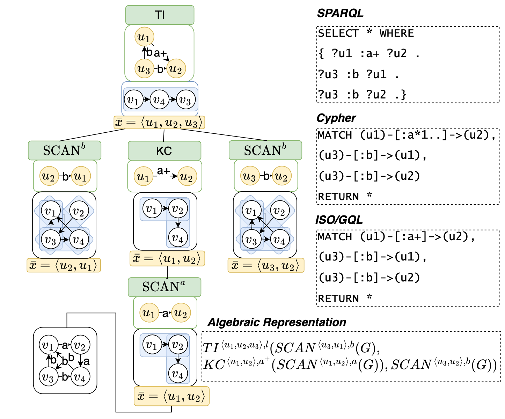

##### 3.1.3.3 六类逻辑算子及其语义

论文在超图模型上定义 SCAN、SJ、TI、KC、UNION 和 INV 六类核心逻辑算子。

**SCAN（扫描）**是代数入口。`SCAN^{⟨x,y⟩,a}(G)` 读取数据图中全部标签为 $a$ 的边，并生成变量顺序为 $\langle x,y\rangle$ 的二元超边；扫描 $a^{-}$ 时交换源、目标顺序；扫描专用通配标签时读取全部边。它把底层数据图转换为满足统一结果定义的超图。

**SJ（Subgraph Join，子图连接）**接收两个分别代表查询子图结果的超图，按公共变量执行自然连接，并投影为指定变量序列。它对应关系连接风格的处理方式，可把两个已经较完整的中间子图组合为更大子图，因而能够表达右深、左深和灌木型连接计划。SJ 特别适合两侧均已具有较高选择性、直接连接中间超边比重复图遍历更经济的情形。

**TI（Traverse-Intersect，遍历—求交）**统一抽象路径连接和子图扩展。其最左操作数可以是已匹配的边、路径或子图；其他操作数必须表示待遍历的边或路径。执行时，对最左结果的每条超边，从相应公共变量出发沿其他操作数向外扩展。如果多条边或路径指向同一个查询变量，则对各自到达的数据顶点集合求交；若该变量已经出现在最左超边中，求交退化为存在性过滤，只有与原有绑定一致的超边才保留。二元 TI 把两段路径首尾相接时，结果标签仍表示路径；涉及多路扩展或子图结果时，输出标记为子图。TI 因而既能表达 RPQ 连接的连续遍历，也能表达最坏情形最优连接中的多路邻接表求交。

**KC（Kleene Closure，Kleene 闭包）**对应 $R^+$ 或 $R^*$。它以某个二元路径超图为输入，通过变量重命名和 TI 迭代地把已有路径终点与初始路径起点连接，累积各轮新超边直到不动点；星号闭包额外表示空路径。KC 的输出仍是二元路径超图，因此可继续作为 TI 的非左操作数参与后续遍历，也可先经 TI 形成子图后再参与 SJ。

**UNION（并）**对应 RPQ 中的选择 `|`，将变量次序和语义兼容的多个路径结果合并为同一超图。**INV（反向）**交换路径的源、目标方向，用于让任意查询边或路径满足 TI 对遍历方向的约束。INV 不改变可达关系本身，而把“从终点反向执行”的计划显式纳入等价空间；在实际物理计划中，它会逐层下推并最终转化为反向索引扫描。

TI 与 SJ 同时存在是该代数区别于既有方案的关键。如果只保留 TI，系统会被限制在从某个起点逐步扩展的计划；如果只保留 SJ，又必须先独立计算各 RPQ 的完整结果再连接。统一计划可依据选择性在两者之间切换，也可让多个 RPQ 同时参加一次 TI，把某些共享变量上的多路约束尽早求交。

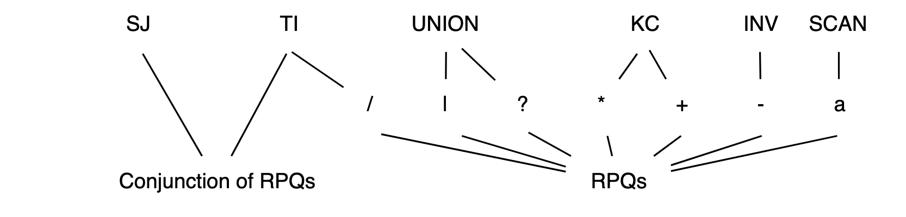

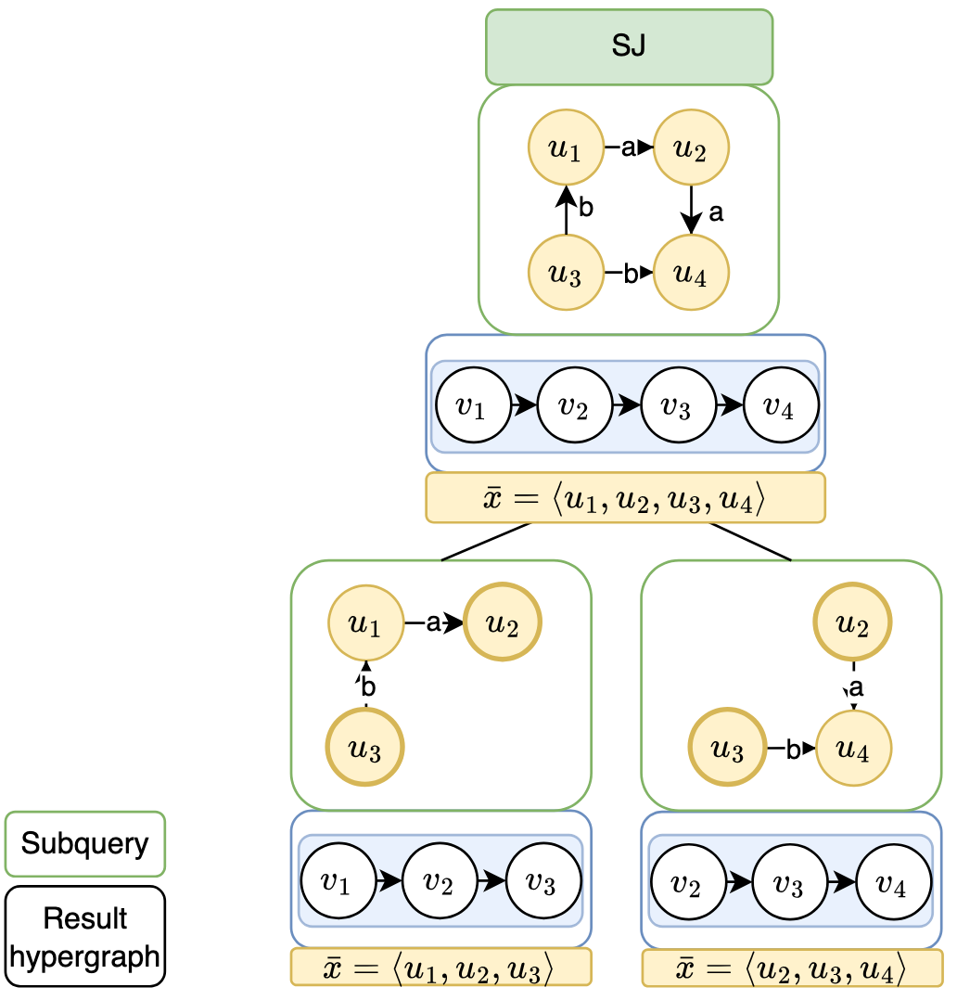

##### 3.1.3.4 逻辑算子的物理实现

论文为上述逻辑代数给出一组可落地但可继续扩展的物理算子映射。

- SCAN 由 BPT-SCAN 实现。底层维护两棵 B+ 树，键分别为“边标签—源—目标”和“边标签—目标—源”。正向、反向标签可通过相应索引的部分键查找直接取得；若源或目标是常量，则把常量并入查找键，在扫描阶段尽早缩小结果。
- SJ 由哈希连接 HJ 实现。超图中的每条超边等价于一行带变量次序的元组，系统在一侧公共变量上建哈希表，再扫描另一侧生成连接超边。该实现适合连接两个已经物化或计算完成的子图结果。
- TI 由 Leapfrog Join（LFJ）实现。对最左超图的每条超边，系统取得其他边或路径操作数在公共变量处的有序邻接列表，通过 leapfrog 指针在多个列表间跳跃，跳过不可能相交的值。SCAN 结果天然按 B+ 树顺序产生；TI、KC、UNION 的路径结果则按需计算并排序，同时把最左超边中已绑定的顶点作为常量下推以驱动执行。若待求交变量是新变量，每个交集值扩展出一条新超边；若它已绑定，则用二分查找验证该值是否存在。
- KC 由缓存辅助闭包 CAKC 实现。首次执行其子计划并缓存 $R$ 的结果，以后每轮只把上一轮新产生的目标作为常量起点，与缓存的 $R$ 连接，避免反复执行整个子计划；新增顶点对去重后加入结果，直至没有增量。对 $R^*$ 的空路径仍使用 $\epsilon$ 标记惰性处理。若闭包源是常量，只能在首轮下推该常量，否则后续各轮只能看到局部数据而导致漏答；若常量位于目标端，则先通过 INV 反转路径，把它转化为可在首轮处理的常量源。
- UNION 由 Merge Union（MU）实现，按有序超边归并多个输入。INV 不设置独立物理算子，而是依据等价规则持续下推到 SCAN，由正反两棵 B+ 树直接承担方向转换。

逻辑算子与物理算子的直接映射保证统一性不只停留在形式代数层面。计划优化器对 TI 与 SJ 的选择会落实为 LFJ 与 HJ 的不同执行行为，对路径方向、常量位置和闭包处理方式的选择也能实际改变索引访问范围和中间结果规模。

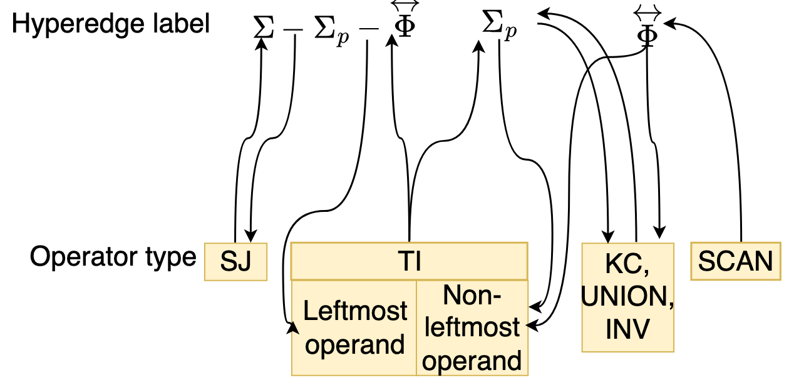

##### 3.1.3.5 完整计划空间与代数变换

CRPQ 的逻辑计划是一棵以逻辑算子为内部节点、以 SCAN 为叶节点的树；物理计划则把各逻辑节点替换为选定物理实现，按后序遍历执行。论文通过构造规范计划证明计划空间的完备性：对每个 RPQ，递归剥离其最高优先级运算并用对应逻辑算子组合子计划；必要时使用 INV 调整路径方向；再通过 TI 逐步连接各 RPQ 子计划。因此任意 CRPQ 至少存在一个由六类算子表达的合法计划。

完备性保证“能表示”，代数等价规则进一步提供“如何枚举更优表示”。主要规则包括：

- TI 具有右递归可约性。多元 TI 可以把任一非左操作数剥离为外层 TI，也可以在变量和标签约束允许时把嵌套 TI 合并；所有非左操作数地位相同，因而可以重排。这一规则同时产生逐条路径扩展和多路径一次求交的候选。
- SJ 具有结合律。优化器可以改变多个局部子图的连接括分方式，从而枚举不同左深、右深及灌木型计划。
- 常量可下推到以 TI 或 UNION 为最低优先级运算的各操作数，在扫描或路径扩展前即限制起点/终点，减少中间结果。KC 的常量处理需遵守前述首轮约束，由 CAKC 专门完成。
- INV 可以穿过 TI、KC 和 UNION 下推。穿过 TI 时还要反转操作数顺序并重命名连接变量；到达 SCAN 后变成读取相反方向标签。这样计划树中不保留额外反向物理操作。

这些规则产生了既有计划空间无法表达的混合方案。论文的运行示例包含三条指向同一顶点的 $b^+$ 路径和两条 $a$ 边。数据图中 $b^+$ 的完整结果很多，最优方案不是先各自算完三条闭包再连接，也不是一次求交全部路径；它先匹配选择性更高的 $a$ 边，再以一次 TI 求交其中两条 $b^+$ 路径，把中间结果缩至一个匹配，随后用第二次 TI 处理剩余 $b^+$。该计划允许共享顶点的查询边分批处理、多个 RPQ 共同参加一次连接，并且不强制查询边按固定顺序进入计划。

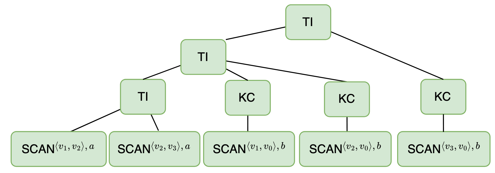

##### 3.1.3.6 计划枚举、代价估计与选择

统一规划由 RPQ 子计划预处理和 CRPQ 全局动态规划两层组成。RPQ 预处理按需进行：单标签或反向标签生成 BPT-SCAN；闭包生成以内部 RPQ 计划为子节点的 CAKC；选择分支由 MU 合并；连接则转入 CRPQ 规划，使路径内部的连接也能与查询图其他边共同考虑。一个 `isINV` 标志沿递归过程传播，直到 BPT-SCAN 决定读取正向还是反向索引。这样，RPQ 并非预先固化为一个不可拆分的自动机，而能在全局计划需要时展开并参与 TI。

CRPQ 规划以查询图的边集合为动态规划状态。对每个含 $k$ 条查询边的连通子图 $Q_k$，`PlanMap` 保存当前估计代价最低的计划。优化器只枚举连通边子集，以避免无笛卡尔积约束的无效中间结果；每个 $Q_k$ 可由两类递推产生：

1. **TI 候选。** 选择一个真子集 $E'_k$ 作为最左子计划，其余一条或多条边/路径必须共享同一查询变量。必要时对待扩展路径使用 INV，使其朝共同变量遍历；随后估计 LFJ 从 `PlanMap[Q'_k]` 扩展和求交这些路径的代价。
2. **SJ 候选。** 把 $E_k$ 划分为两个均能诱导连通子图的非空集合，读取二者在 `PlanMap` 中的最优计划，并估计 HJ 在公共变量上的连接代价。

优化器比较所有合法 TI 和 SJ 候选，只为该边集合保留代价最低者，直至得到完整查询图计划。它由代价决定在“遍历—求交”和“子图—子图连接”之间选择，而不是预设某一种连接范式。

基数估计扩展了面向子图匹配的蓄水池采样方法。传统方法按已绑定查询顶点集合维护样本，但 TI 允许同一顶点相邻的边分多次处理，因此论文改为按已处理查询边集合维护若干中间结果样本。样本从 $E_{k-1}$ 经一次 TI 扩展到 $E_k$；若原样本数为 $S(E_{k-1})$，成功扩展出的行数为 `count`，则

$$
\operatorname{card}(E_k)\approx
\max\left(\frac{\text{count}}{S(E_{k-1})}\operatorname{card}(E_{k-1}),1\right)。
$$

扩展过程中继续进行蓄水池采样，控制统计开销；若 TI 含常量起点，采样直接从该常量开始，常量终点则先通过反向规则转化。物理代价在子计划代价和输出基数之外显式考虑 LFJ 的求交与排序：一次多路 LFJ 的主要开销随最短邻接表长度以及最长、最短列表长度比的对数增长，尚未有序的路径结果还需计入排序开销；二元 TI 不需要多路求交和额外排序。HJ、CAKC、MU 则分别按输入/输出基数、闭包增量轮次和归并规模计入。该模型使计划选择能反映邻接列表分布、路径闭包规模和中间子图大小，而非只比较算子数量。

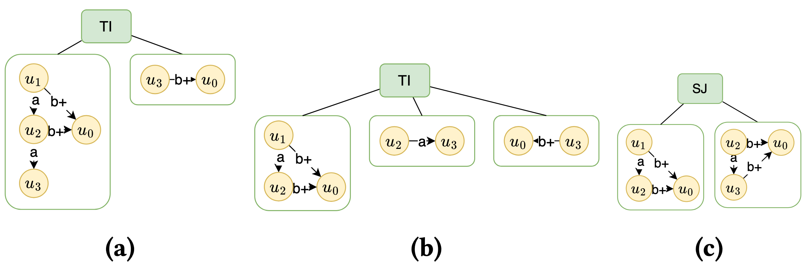

##### 3.1.3.7 系统实现与实验结果

论文分别基于 MillenniumDB 的存储层和 Neo4j 的用户自定义过程接口实现统一算子与规划器，在 WDBench 的 Wikidata 图和 LDBC SNB SF10 属性图上实验。Wikidata 包含 348,945,080 个顶点、958,844,164 条边和 5,419 种标签；SF10 包含 36,485,761 个顶点、231,371,359 条边和 15 种标签。测试查询从两个基准提取，覆盖不同 RPQ 数量、标签数量、闭包数量和常量顶点数量；端到端时间同时包含规划和执行，并设置 60 秒超时。

在 WDBench 上，统一框架平均端到端查询时间由 MillenniumDB 的 5.5544 秒降至 2.6662 秒，平均加速 2.0833 倍，最大加速约 66,703 倍，超时查询数由 186 降至 60，下降约 68%。在 LDBC SNB 上，相对 Neo4j 平均加速 1.6833 倍，最大加速 224.85 倍。时间分解显示，两种系统的规划时间相近，主要收益来自执行阶段：统一优化器选出的计划缩小了高基数标签、无界闭包和多个 RPQ 共同造成的数据图搜索空间。

复杂度分组实验进一步改变 RPQ 数、边标签总数、Kleene 闭包数和常量顶点数。统一框架在几乎所有复杂度层级上均具有更低平均时间和更少超时；对于包含 9 个 RPQ、11 个边标签的高复杂度查询，MillenniumDB 全部超时，统一框架仍能完成。结果表明，超图模型和公共算子的作用不是把两类既有计划并列存放，而是提供原先不存在的跨边、跨路径重组机会；代价驱动的全局选择使这些新计划在复杂查询上转化为稳定的数量级性能改善。

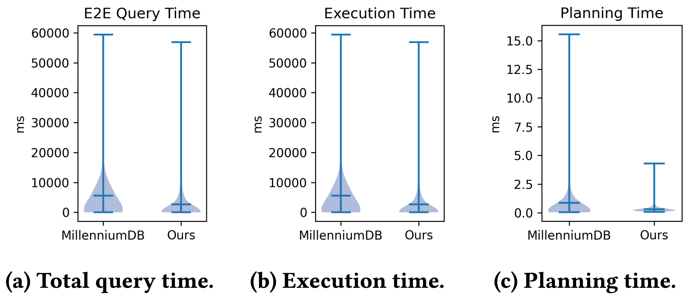

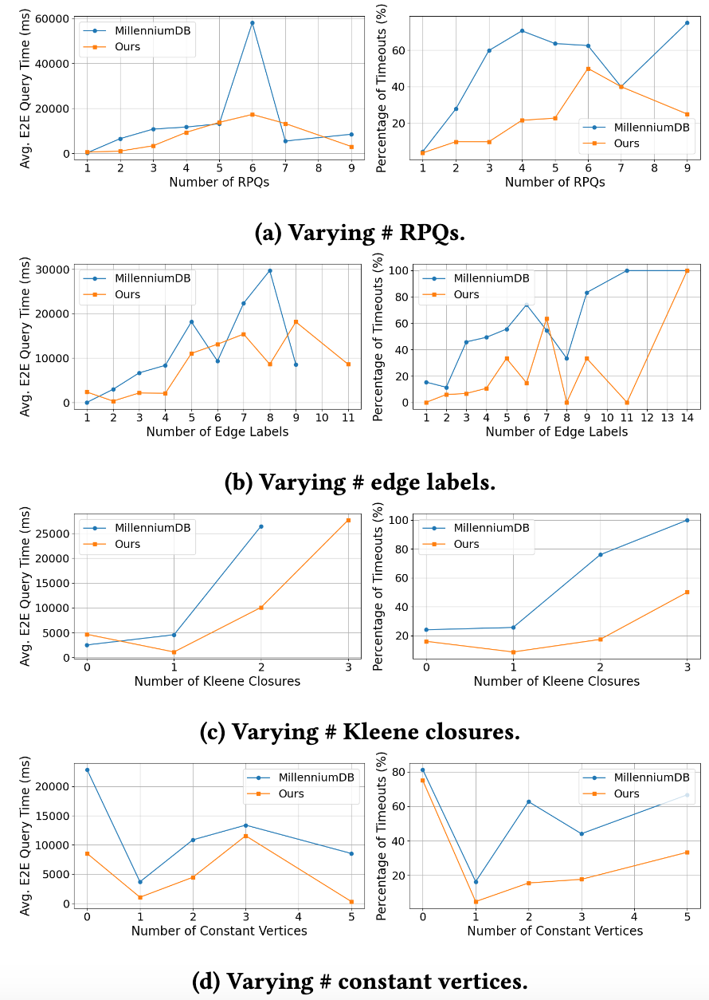

本技术点的代表性论文为 Yue Pang、Lei Zou、Angela Bonifati、M. Tamer Özsu、Xiaofang Zhou 的 *A Unified Query Planning Framework for Conjunctive Regular Path Queries*，发表于 *Proceedings of the VLDB Endowment* 19(10): 2686–2698（2026）。相关发明专利申请为“一种面向合取正则路径图查询的计划优化与执行方法及系统”（ZL 202610776973.7）。

#### 3.1.4 面向 UNION、OPTIONAL 的复杂 SPARQL 查询优化

本技术点对应论文 *Efficient Execution of SPARQL Queries with OPTIONAL and UNION Expressions*。论文先从 SPARQL-UO 的标准语义和 BGP 执行瓶颈出发，引入介于查询语法与关系代数计划之间的 BE-tree；随后给出分别针对 UNION、OPTIONAL 的 Merge 和 Inject 等价变换，建立变换前后的代价模型与贪心选择算法；最后在执行过程中加入候选集剪枝，并通过多引擎、大规模 RDF 数据实验验证。以下按这一顺序介绍。

##### 3.1.4.1 SPARQL-UO 的语义与优化难点

RDF 数据是主语、谓词、宾语三元组的集合，知识图谱通常不强制统一模式并允许事实缺失。UNION 用于合并同一信息的不同表达，例如 DBpedia 中人名可能使用 `foaf:name` 或 `rdfs:label`；OPTIONAL 用于在保留主体匹配的同时附加可能不存在的信息，例如为所有美国总统返回 `owl:sameAs` 外部引用，而不因某位总统没有该属性就将其过滤。真实 SPARQL 日志中，UNION 和 OPTIONAL 分别出现在 25.10% 和 31.72% 的有效查询中，因而不是少见的边缘语法。

论文把由 AND、UNION、OPTIONAL 及分组图模式构成的查询称为 SPARQL-UO。一个三元组模式中的位置可以是变量或 RDF 常量；若干三元组模式在主语或宾语位置共享变量，并形成连通查询子图时，可合并为基本图模式 BGP。BGP 在 RDF 数据集上的结果是变量到 IRI 或字面量的映射袋，保留重复项。两个映射在全部公共变量上取值相同才相容；AND 对应相容映射的自然连接，UNION 对应袋并，OPTIONAL 对应左外连接。

如果严格按语法树自底向上执行，每个叶节点先独立匹配一条三元组，再逐层连接。低选择性三元组会生成海量中间映射，例如独立查询“某人的出生日期”几乎遍历全部人物；而成熟 RDF 引擎已经能够在一个 BGP 内优化连接顺序、使用图索引或执行最坏情形最优连接。论文因此把 BGP 而非单个三元组作为高层计划的基本执行单元，在复用既有 BGP 引擎能力的同时，专门优化 UNION、OPTIONAL 跨 BGP 形成的搜索空间与中间结果。

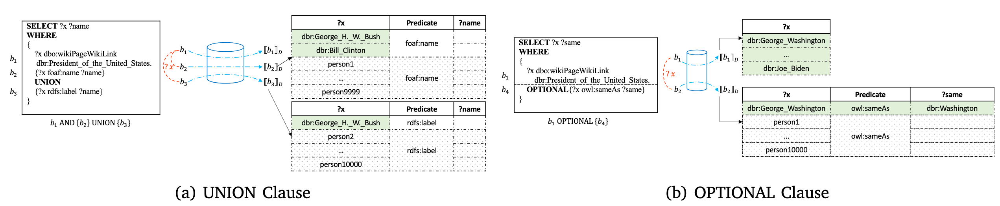

##### 3.1.4.2 BE-tree 与 BGP 驱动的执行计划

项目组提出 BGP-based Evaluation Tree（BE-tree）作为 SPARQL 查询与最终关系代数计划之间的中间表示。给定最外层分组图模式 $Q$，BE-tree 的根是分组图模式节点；内部节点可为分组、UNION 或 OPTIONAL；UNION 有两个或更多分组子节点，OPTIONAL 只把右侧可选分组表示为其子节点，其左侧必选模式仍位于同一外层分组中；叶节点全部是 BGP。

构造时，系统先解析 SPARQL 的括号范围和运算优先级，再把同一分组下所有可合并的兄弟三元组/BGP 反复合并，直到形成极大 BGP。对于跨 OPTIONAL 两侧的模式，只有查询满足 well-designed OPTIONAL 的变量约束时才允许相应合并，以保证标准语义。BE-tree 保留 UNION、OPTIONAL 的嵌套和分组结构，因而便于从查询语法构造和理解；同时叶节点已是能直接交给 gStore、Jena、Blazegraph 等引擎的 BGP。

执行前，BE-tree 转换为关系代数计划：BGP 保持为叶节点，AND、UNION、OPTIONAL 分别映射为自然连接、袋并和左外连接内部节点。转换过程对 BE-tree 做深度优先遍历并优先处理右侧子节点，自右向左构造二叉或多叉代数树；一个分组节点可能展开为一个或多个连接节点。执行器再次深度优先遍历代数计划：到达 BGP 时调用底层 `EvaluateBGP`，返回时按内部节点语义组合映射袋。BE-tree 由此承担两个作用：它把复杂 SPARQL 的语法范围无歧义地保留下来，同时为关系代数上的等价变换提供比原始语法树更清晰的 BGP 边界。

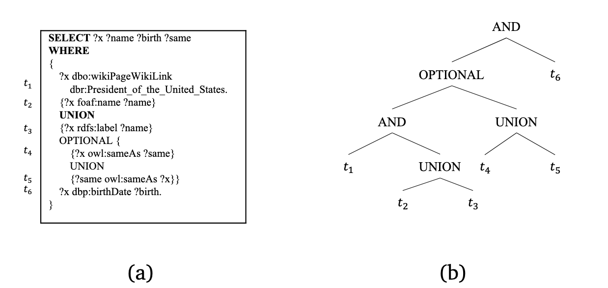

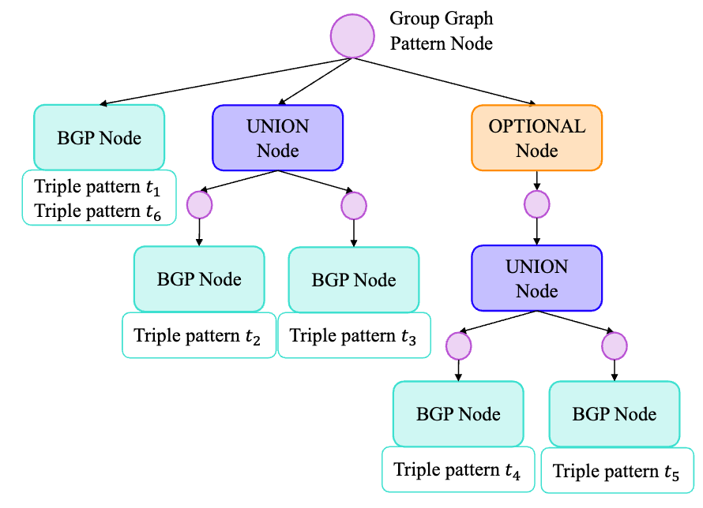

##### 3.1.4.3 Merge 与 Inject 语义保持变换

直接执行 BE-tree 对应的代数计划仍可能先算出低选择性 UNION 分支或 OPTIONAL 右侧的完整结果。论文从袋语义下的关系代数等价式出发，提出两类变换。

**Merge 变换面向 UNION。** 对任意图模式 $P_1,P_2,P_3$，连接对袋并满足分配律：

$$
P_1\ \text{AND}\ (P_2\ \text{UNION}\ P_3)
\equiv
(P_1\ \text{AND}\ P_2)\ \text{UNION}\
(P_1\ \text{AND}\ P_3)。
$$

若 BGP $P_1$ 与其兄弟 UNION 的至少一个分支 BGP 共享可合并变量，Merge 将 $P_1$ 复制到所有 UNION 分支的最左侧，在每个分支内与可合并 BGP 形成新的极大 BGP，再从原位置移除 $P_1$。当 $P_1$ 选择性高时，底层 BGP 引擎可先利用它限制各分支，显著减少袋并前的结果；但 $P_1$ 也因此在各分支重复执行。若 $P_1$ 选择性低，分支没有得到有效过滤，复制反而增加开销，所以并非所有合法 Merge 都值得执行。

**Inject 变换面向 OPTIONAL。** 左外连接满足

$$
P_1\ \text{OPTIONAL}\ P_2
\equiv
P_1\ \text{OPTIONAL}\ (P_1\ \text{AND}\ P_2)。
$$

若 BGP $P_1$ 与右侧 OPTIONAL 子树中的 BGP $P_2$ 可合并，Inject 把 $P_1$ 插入右侧分组并与第一个可合并 BGP 合并，但保留 $P_1$ 在左侧的原始出现。这样不会改变任何左侧映射：能够匹配可选部分者获得扩展，不能匹配者仍由左外连接保留。技术效果是让底层 BGP 引擎从 $P_1$ 的候选绑定出发，只生成与这些绑定相关的可选信息，而不是独立求出全部 $P_2$ 后再做昂贵左外连接。

论文以美国总统查询说明 Inject：`owl:sameAs` 在 DBpedia 中匹配大量实体，独立执行会产生庞大结果；总统 BGP 高度选择性，把它注入可选分支后，系统只查找已识别总统的等价引用，同时缩小 BGP 计算和左外连接两部分代价。两类变换都要求 BGP 可合并；若不存在公共图变量，复制或注入无法形成内部连接过滤，只会重复计算。

在 BE-tree 上，候选目标表现为 BGP 的兄弟 UNION/OPTIONAL；映射到二叉关系代数计划后，这一范围不再直观。论文定义 `scope(b)`：从 BGP $b$ 沿允许的连接/左外连接祖先向上寻找局部根，再向下收集可通过相应算子到达的袋并或左外连接节点。Merge 的作用域不能跨越 OPTIONAL，以避免改变必选与可选语义；Inject 则在 well-designed 前提下允许沿连接和外连接路径寻找右侧目标。

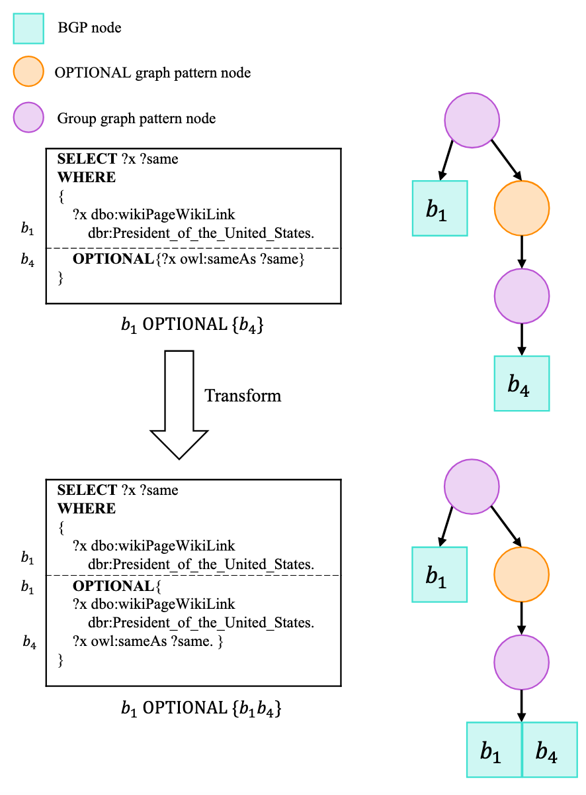

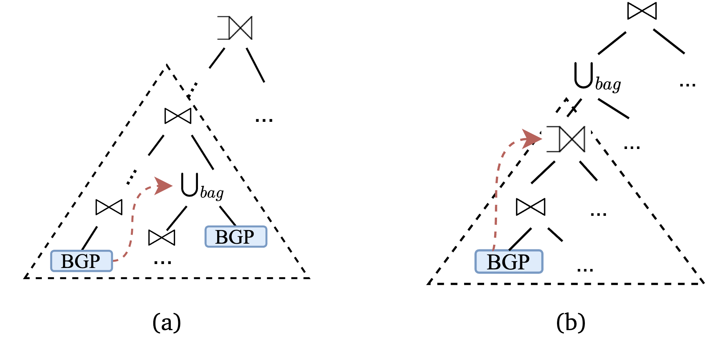

##### 3.1.4.4 变换代价模型与计划选择

合法等价变换可能降低也可能提高代价，因此优化器不使用“遇到 UNION/OPTIONAL 就改写”的固定规则，而计算变换前后的 $\Delta$-cost。总成本分为两部分：底层引擎执行 BGP 的成本，以及自然连接、袋并和左外连接等高层代数算子的成本。优化器只比较一次变换直接影响的局部计划，避免因反复估计全部祖先而增加规划开销。

对 Merge，变换前的局部成本包括外层 BGP、UNION 各分支原 BGP 和袋并运算；变换后包括各个合并 BGP、无法合并的分支为连接外层 BGP 而新增的自然连接，以及操作数规模变化后的袋并。对 Inject，变换前包括 OPTIONAL 右侧目标 BGP、左外连接以及从 OPTIONAL 到该 BGP 路径上的连接节点；变换后则以合并 BGP 和更新后的各代数节点重新估计。只有变换后成本小于变换前，即收益为正时才实际应用。

BGP 的基数和执行代价由底层引擎提供。以 gStore 的实现为例，BGP 采用最坏情形最优连接；每扩展一个查询顶点，代价由已有部分匹配数乘以相关谓词的最小平均邻接表长度估计。基数从单三元组模式的精确统计开始，在扩展查询顶点时对当前候选行采样，以成功扩展比例放大上一阶段基数：

$$
\operatorname{card}(V_k)=
\max\left(
\frac{\#\operatorname{extend}}{\#\operatorname{sample}}
\operatorname{card}(V_{k-1}),1
\right)。
$$

高层模型中，自然连接或左外连接的代价按两侧结果规模的乘积近似，袋并代价按各分支规模之和近似；相应内部节点的结果基数也由操作数基数递推。模型虽然采用简化分布假设，但能够同时比较“提前过滤节省的中间结果”和“复制 BGP 或新增连接带来的额外计算”，正是决定 Merge/Inject 是否有利所需的关键信号。

处理单个 BGP 时，算法先在其作用域内查找全部可变换 UNION 和 OPTIONAL。由于 Merge 会从原位置移走 BGP，一个 BGP 最多只能与一个 UNION 合并，优化器计算所有候选的 $\Delta$-cost，选择收益最大且确有收益者；Inject 保留原 BGP，各 OPTIONAL 候选在语义上可独立处理，因此逐一应用有收益的注入。

完整计划中多个 BGP 的变换可能彼此依赖。例如三层嵌套 OPTIONAL 可选择把 $P_1$ 注入 $P_2$、把 $P_2$ 注入 $P_3$，或把 $P_1$ 继续影响更深层，组合数随计划深度指数增长。为平衡规划时间和计划质量，论文对代数计划节点做拓扑排序，再按逆拓扑顺序处理 BGP：先固定更靠近叶部的局部变换，再逐层处理上方 BGP，不对已经确定的下层方案进行指数级回溯。这一贪心顺序使规划成本可控，同时保留选择性从外层传播到主要 UNION/OPTIONAL 分支的机会。

##### 3.1.4.5 运行时候选集剪枝

树变换发生在执行前，但一次只围绕一个 BGP 进行，无法覆盖所有跨层约束。项目组进一步提出 Candidate Pruning，在执行时把已经得到的小结果作为下层 BGP 的候选绑定。其依据仍是前述代数等价：UNION 分支或 OPTIONAL 右侧最终只有在公共变量上与外层结果相容时才可能进入答案，因而无须为其他变量取值生成完整匹配。

当深度优先执行遇到袋并或左外连接时，执行器先求得当前外层结果，把其中公共变量的取值传给子 BGP；`EvaluateBGP` 以这些取值限制对应查询顶点，只在候选诱导的邻接范围内匹配。例如外层已经得到少量 `?x`，OPTIONAL 右侧只为这些 `?x` 查找属性，而不扫描数据集中所有具有该属性的实体。结果以指针方式传递，可避免复制大映射袋。

候选传递本身也有扫描和建索引开销，只有候选集合小于 BGP 原结果时才可能受益。系统采用自适应阈值：若规划阶段已得到 BGP 基数估计，就以该估计决定是否启用；无统计时则按数据集规模设置阈值。候选过大时仍按原计划独立执行，避免“剪枝集合本身比被剪枝结果更大”。

候选剪枝与树变换形成互补。树变换可以把尚未得到外层结果、因而运行时无法剪枝的高选择性 BGP 提前合并到 UNION/OPTIONAL 分支，先把大分支拆小；候选剪枝则可跨多层嵌套持续传递已经得到的小结果，弥补贪心变换无法把一个 BGP 直接注入所有深层节点的问题。例如在 `P1 OPTIONAL {P2 OPTIONAL {P3}}` 中，即使计划变换只把 $P_1$ 注入 $P_2$，执行时 $P_1$ 的候选仍可经 $P_2$ 传到 $P_3$。当只有一个 BGP 和一个 UNION/OPTIONAL 可变换时，静态变换与候选剪枝效果等价，系统跳过树改写以减少额外开销。

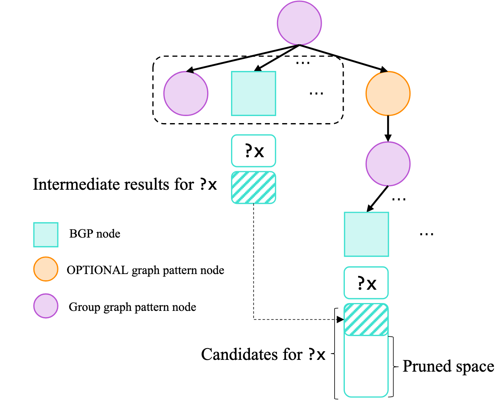

##### 3.1.4.6 实验验证与技术效果

论文把方法分别接入 gStore、Apache Jena 和 Blazegraph 的 BGP 执行模块，在合成 LUBM 以及真实 DBpedia、YAGO 数据上验证。三个数据集分别包含约 5.34 亿、8.30 亿和 2.31 亿条三元组；DBpedia 包含 57,471 种谓词，能够检验方法面对高度异构真实知识图谱时的适应性。测试查询同时覆盖纯 UNION、纯 OPTIONAL 和两者混合，并以 BGP 数量和最大分组嵌套深度刻画结构复杂度。

消融实验比较四种方案：只使用 BGP 驱动执行的基线 `base`；只做树变换的 `TT`；只做候选剪枝的 `CP`；联合二者的 `full`。三种底层引擎上趋势一致，说明高层优化不依赖某一种 BGP 存储或连接实现。TT 适合查询开头没有可用小结果、但后续存在高选择性 BGP 可 Merge/Inject 的情形；CP 适合高选择性结果之后跟随多层低选择性 OPTIONAL 的情形；混合查询中两者累计生效。`full` 总体具有最小连接空间和最低执行时间，最高加速约一个数量级。基线在相应 24 个测试中有 13 个因内存不足失败，完整方案全部完成。

论文进一步定义连接空间：BGP 的连接空间取其结果基数，AND/OPTIONAL 取两侧连接空间乘积，UNION 取各分支之和。该指标近似执行期间可能物化的最大中间空间。各查询中，TT、CP 的连接空间均小于基线，full 总体最小，并与实际执行时间和内存趋势一致，直接验证优化收益来自减少无关匹配和中间结果，而不是仅改变算子调用常数。

与当时专门优化 OPTIONAL 的 LBR 比较时，完整方案在全部测试上更快。对外层具有高选择性 BGP 的简单 OPTIONAL，候选剪枝明显轻于 LBR 的两遍半连接、nullification 和 best-match；对缺少高选择性模式的复杂嵌套查询，本方法仍受益于以 BGP 为基本单元的执行。最后，论文把 LUBM 扩展到 10 亿、15 亿和 20 亿条三元组，完整方案的执行时间随数据规模近似线性增长；增长速度主要由查询答案规模决定，显示计划变换与候选传递没有引入超线性控制开销。

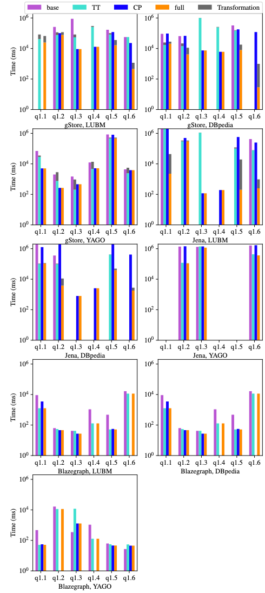

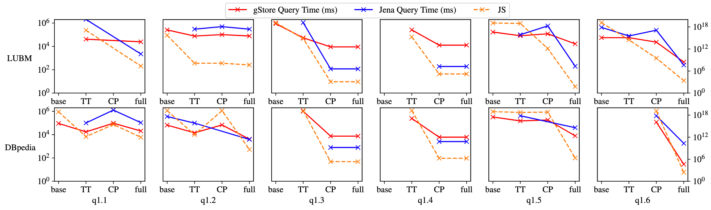

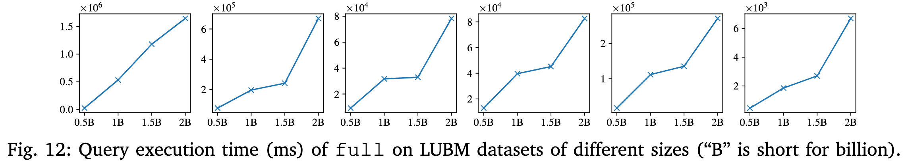

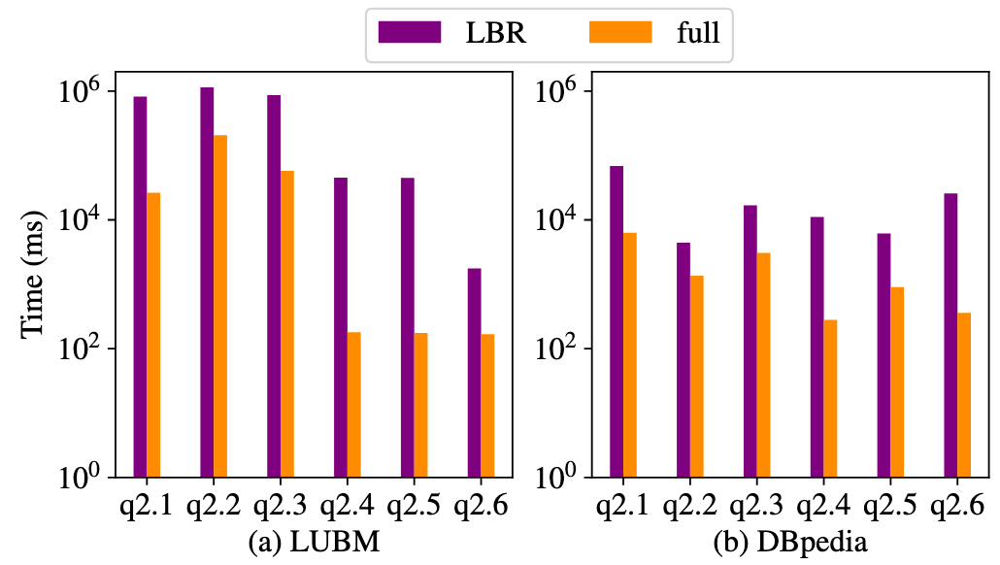

本技术点的代表性论文为 Yue Pang、Lei Zou、M. Tamer Özsu、Jiaqi Chen 的 *Efficient Execution of SPARQL Queries with OPTIONAL and UNION Expressions*，发表于 ICDE 2025: 2755–2767。相关发明专利为“查询数据的方法、装置、设备及存储介质”（ZL 202111673409.6）。

#### 3.1.5 技术体系总结

上述三项扩展研究分别解决了统一图查询技术中的不同层次问题。RPQ 物化视图工作以 AODC 把多查询共享、视图冗余和基于视图的增量规划统一起来，使路径工作负载能够在有限内存内进行全局优化；CRPQ 工作以序列超图和六类公共算子弥合子图匹配与正则路径查询的计划表示差异，使二者能够在同一代数空间内交错枚举并由代价选择；SPARQL-UO 工作则以 BE-tree、关系代数等价变换和运行时候选传递，把底层 BGP 引擎的选择性跨越 UNION、OPTIONAL 边界传播。三者共同形成从单路径、多路径合取到复杂分支/可选语义的连续优化链条，其核心是用可组合的计划表示暴露等价执行空间，再以基数、代价和运行时约束控制中间结果规模。
